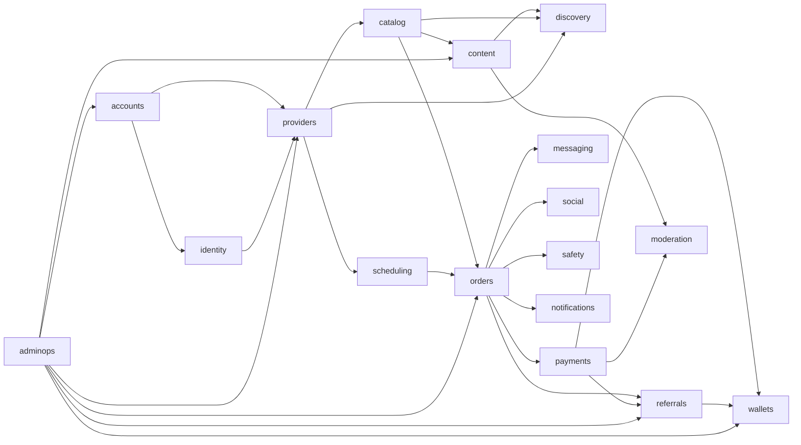

# PRD 全面需求分析

## 0. 阅读基线与结论标识

- 基线：`见面聊_PRD_v6_后端完整版.md`，共 1982 行，SHA-256 为 `E2247A9ADA1271F96D73058778979851955DE9509AEAED150E9684FFC5BCB087`。
- `[PRD]`：PRD 明文要求。
- `[DESIGN]`：由 PRD 推导出的后端技术设计，不等于产品确认。
- `[CONFIRM]`：必须由产品、业务、财务、法务或技术负责人确认。

## 1. 项目业务模块清单

| 模块 | PRD 已明确 | 后端设计推导 | 待确认 |
|---|---|---|---|
| 用户与认证 | 手机号、微信、Apple ID、游客浏览、注销、首次身份选择、工作区切换 `[PRD]` | `accounts`，第三方账号映射、设备会话、身份选择幂等 `[DESIGN]` | 存量用户身份补选、注销冷静期与数据处置 `[CONFIRM]` |
| 身份与认证 | 手机号、实名、人脸、技能、服务者认证 `[PRD]` | `identity`，凭证加密、第三方核验适配、状态日志 `[DESIGN]` | 实名/人脸厂商、失败重试和凭证保留期 `[CONFIRM]` |
| 服务陪伴者入驻 | 资料、照片、类目、审核、拒绝重提、双身份 `[PRD]` | `providers` 应用审核命令和权限开通事务 `[DESIGN]` | 入驻门槛、收费/押金、审核 SLA `[CONFIRM]` |
| 服务与排期 | 类目、服务价格/时长/上下架、每周可约时段、订单锁时段 `[PRD]` | `catalog` + `scheduling`，规则展开为具体 slot 并加唯一约束 `[DESIGN]` | 最小预约提前量、时区、缓冲、超售策略 `[CONFIRM]` |
| 动态与资讯 | 动态双列/全屏、图文视频、评论点赞、挂载服务、资讯和投稿 `[PRD]` | `content`，内容版本、媒体、审核、互动计数 `[DESIGN]` | 先审后发/先发后审、资讯来源、评论是否 MVP `[CONFIRM]` |
| 搜索与推荐 | 服务者/服务/动态/资讯搜索，多维筛选，MVP 推荐 `[PRD]` | `discovery` 先 PostgreSQL，推荐 Provider 可替换 `[DESIGN]` | 搜索权重、隐私展示、推荐冷启动规则 `[CONFIRM]` |
| 订单与履约 | 下单、接单/拒单、改期、打卡、完成、24h 自动完成、取消 `[PRD]` | `orders` 状态机、快照、状态日志、并发控制 `[DESIGN]` | 双方打卡条件、改期次数、超时、完成和售后边界 `[CONFIRM]` |
| 支付与退款 | 微信/支付宝、托管、原路退款、重试、支付凭证 `[PRD]` | `payments`，支付单、回调、退款单、对账 `[DESIGN]` | 商户主体、支付产品、退款规则和违约金 `[CONFIRM]` |
| 资金与结算 | 平台佣金、T+1/T+7、钱包、提现、账单、对账 `[PRD]` | `wallets` 不可变流水、账户、提现、日对账 `[DESIGN]` | 佣金、结算周期、提现门槛/手续费、托管/分账模式 `[CONFIRM]` |
| 推广奖励 | 一级邀请、比例动态配置、订单快照、退款取消/冲减、奖励账户 `[PRD]` | `referrals`，政策版本、奖励单、调整流水 `[DESIGN]` | 奖励比例、资金来源、观察期、提现和反作弊规则 `[CONFIRM]` |
| IM 与消息 | 仅订单关系解锁、多类型消息、未读、客服、订单完成后保留 `[PRD]` | `messaging` 管授权与会话，IM 能力走适配器 `[DESIGN]` | IM 厂商、消息留存、撤回、审核和客服系统边界 `[CONFIRM]` |
| 社交与评价 | 收藏、关注、互评、追评、匿名、评分、信用和申诉 `[PRD]` | `social`，唯一互动、评分聚合、信用流水 `[DESIGN]` | 信用加减分、阈值、追评/匿名展示规则 `[CONFIRM]` |
| 安全保障 | 一键报警、行程分享、紧急联系人、公共场所 `[PRD]` | `safety`，证据留存和最小化位置访问 `[DESIGN]` | 报警接口方式、位置精度和法律流程 `[CONFIRM]` |
| 通知 | 订单、私信、动态、系统、营销通知，多渠道与偏好 `[PRD]` | `notifications` 模板、发送记录、重试 `[DESIGN]` | 推送厂商、营销授权和免打扰口径 `[CONFIRM]` |
| 内容审核与风控 | AI 预审、人工复核、敏感词、举报、黑名单、反刷单 `[PRD]` | `moderation` 适配第三方，保留证据和决策日志 `[DESIGN]` | 审核策略、阈值、申诉 SLA、自动处置范围 `[CONFIRM]` |
| 运营后台 | 用户/服务者/内容/订单/财务/数据/推广管理 `[PRD]` | `adminops` RBAC、审批、审计、报表查询 `[DESIGN]` | 岗位权限矩阵、财务复核、客服权限 `[CONFIRM]` |
| 配置与合规 | 类目、城市、佣金、退款、提现、奖励、协议版本 `[PRD]` | `common/config` 版本化配置和同意记录 `[DESIGN]` | 各项具体数值和法务文案 `[CONFIRM]` |

## 2. 模块依赖关系



依赖原则：

- `[DESIGN]` `common` 和 `integrations` 是底层能力，不允许依赖业务模块。
- `[DESIGN]` `orders` 编排交易流程，但支付成功事实只能由 `payments` 在验证渠道回调后产生。
- `[DESIGN]` `wallets/referrals` 以事件和业务单号入账，不直接读取订单服务内部事务。
- `[DESIGN]` `discovery` 只消费公开投影/索引，不阻塞核心交易。
- `[DESIGN]` `adminops` 使用业务模块公开命令，不能绕过状态机。

## 3. 核心业务流程

### 3.1 注册、邀请和身份选择

1. `[PRD]` 用户可通过手机号、微信、Apple ID 注册；邀请链接/邀请码在注册时携带归因。
2. `[PRD]` 新用户必须选择一次“普通用户”或“服务陪伴者”；重复提交同一身份幂等成功，已选择后不能用首次选择接口改身份。
3. `[PRD]` 邀请关系仅一级、每个新用户最多一个直接邀请人，禁止自邀请。
4. `[DESIGN]` 注册、认证凭据、归因候选、首次身份选择和事件写入按清晰事务边界处理；归因风险检查异步补全，但绑定结果不可覆盖。
5. `[CONFIRM]` 存量未选身份用户、注销后重注册、归因冲突优先级和异常人工改绑规则。

### 3.2 服务者入驻

1. `[PRD]` 提交资料、照片和类目，完成实名与人脸认证，平台审核。
2. `[PRD]` 通过后开通服务者能力；拒绝后可修改重提；普通用户能力不消失。
3. `[DESIGN]` 审核通过在同一事务内更新申请、用户服务身份、服务者资料、审核日志和 Outbox。
4. `[CONFIRM]` 审核标准、照片数量、技能认证方式、SLA 和入驻收费。

### 3.3 服务发现、下单和履约

1. `[PRD]` 用户从首页/动态/资讯进入服务者主页或服务详情，选择服务、时间、公共场所和备注。
2. `[PRD]` 支付成功后解锁指定服务者私信，订单进入待接单；服务者接受/拒绝/建议改期。
3. `[PRD]` 双方见面打卡后进入履约中；服务者点击完成，用户确认，24 小时无操作自动完成。
4. `[DESIGN]` 下单事务创建服务/价格/规则快照并锁定排期；支付成功才释放到待接单；所有转换校验当前状态、操作者和对象归属。
5. `[CONFIRM]` 双方打卡到底是一人还是两人、地点距离校验、改期规则、接单超时、迟到和自动完成细节。

### 3.4 支付、退款、结算和奖励

1. `[PRD]` 支付经微信/支付宝，支付成功记录订单实付并锁定奖励比例。
2. `[PRD]` 订单完成后按平台佣金规则形成服务者收入；奖励不因支付直接发放，而在订单完成和退款/风控观察后处理。
3. `[PRD]` 全额退款取消奖励，部分退款按有效实付金额重算并冲减；奖励不超过当笔平台佣金是 PRD 建议，仍需确认。
4. `[DESIGN]` 支付、退款、结算、奖励、提现均使用唯一业务单号、幂等键、不可变流水和事务内状态转换。
5. `[CONFIRM]` 佣金、奖励、资金来源、结算观察期、退款/违约金、提现和税务口径。

### 3.5 内容、IM 和安全

1. `[PRD]` 动态/资讯经审核展示；用户可点赞、评论、收藏、关注、分享和举报。
2. `[PRD]` 只有存在有效订单关系的用户和服务者可私信；系统消息不受此限制。
3. `[PRD]` 履约中提供报警和行程分享；精确位置只在安全场景使用。
4. `[DESIGN]` 内容审核、IM 消息和安全事件均需证据、状态和审计；第三方失败时明确降级，不能静默放行。

## 4. 角色与权限

| 角色 | PRD 权限 | 后端权限约束 | 待确认 |
|---|---|---|---|
| 游客 | 浏览首页/动态/资讯，操作时强制登录 `[PRD]` | 只允许公开只读 API；限制浏览数量和搜索频率 `[DESIGN]` | 游客可浏览卡片准确数量 `[CONFIRM]` |
| 普通用户 | 浏览、收藏、关注、下单、支付、评价、投诉、举报、订单、资料 `[PRD]` | 资源必须属于本人；下单需账号有效且实名；不能改订单业务金额 `[DESIGN]` | 实名是否下单前所有支付均强制 `[CONFIRM]` |
| 服务陪伴者 | 普通用户能力 + 动态、服务、排期、接单、订单、提现 `[PRD]` | 只能操作自己的服务/订单/排期；接单前校验认证、启停和时段 `[DESIGN]` | 服务者等级、限流和提现条件 `[CONFIRM]` |
| 客服 | 咨询、投诉、纠纷、退款申请处理 `[PRD]` | 只读订单和必要脱敏信息；不能改资金余额、不能自行通过提现；操作留审计 `[DESIGN]` | 客服可看到的聊天/身份字段和退款权限 `[CONFIRM]` |
| 平台管理员 | 审核、仲裁、资金、风控、活动、数据 `[PRD]` | RBAC 细分权限；高风险操作双人复核/二次确认 `[DESIGN]` | 管理岗位、权限矩阵和审批链 `[CONFIRM]` |
| 系统任务 | 状态超时、补偿、结算、对账 `[PRD]` | 以系统操作者执行，必须幂等、可重放、留日志 `[DESIGN]` | 自动处置边界和告警人 `[CONFIRM]` |

## 5. 核心数据库实体及关联

| 实体 | 关键关联 | 关键约束 |
|---|---|---|
| `users` | 1:N `user_auths`、`certifications`、`provider_profiles`、订单、钱包 | `invite_code` 唯一；邀请人不能是自己；年龄约束需由生日/实名结果确定 |
| `user_auths` | N:1 用户 | `auth_type + auth_identifier` 唯一 |
| `provider_applications` | N:1 用户 | `application_no` 唯一；审核状态日志 |
| `provider_profiles` | 1:1 用户；1:N 服务、排期 | 用户最多一个有效服务者档案 |
| `services` | N:1 provider；N:1 category；1:N media/slots | `service_no` 唯一；价格非负 |
| `schedule_slots` | N:1 provider/service；0:1 order | 同一 provider 时段不可重叠或重复占用 |
| `moments` | N:1 user/provider；N:1 attached service；1:N media/comments/likes | 可见性、审核状态、计数约束 |
| `orders` | N:1 user/provider/service；1:1+ payment/refund/reward snapshot | `order_no` 唯一；金额守恒；状态日志 |
| `payments` | 1:N callbacks；N:1 order | `payment_no` 唯一；渠道交易号防重复 |
| `refunds` | N:1 order/payment | `refund_no` 唯一；累计退款不超过实付 |
| `wallet_accounts` | 1:N transactions/withdrawals | 账户类型和用户唯一；余额由流水校验 |
| `referral_attributions` | invitee 用户唯一；inviter/invitee | 首次有效绑定不可覆盖；风险状态可冻结 |
| `referral_rewards` | 一订单最多一条 | `reward_no`、`order_id` 唯一；政策快照不可改 |
| `conversations` | 关联订单和成员 | 同一订单的有效会话唯一 |
| `admin_users/roles/permissions` | RBAC | 敏感命令必须权限 + 审计 |

## 6. API 模块划分

| 前缀 | 模块 | 典型资源 |
|---|---|---|
| `/api/v1/auth` | 认证 | 验证码、登录、第三方登录、退出 |
| `/api/v1/users` | 用户 | 资料、身份、工作区、注销 |
| `/api/v1/providers` | 服务者 | 主页、入驻申请、服务者状态 |
| `/api/v1/services`、`/schedules` | 服务与排期 | 服务、上下架、slot |
| `/api/v1/moments`、`/articles` | 内容 | 动态、资讯、评论、互动 |
| `/api/v1/search`、`/recommendations` | 发现 | 搜索、筛选、推荐 |
| `/api/v1/orders` | 交易 | 下单、接单、改期、打卡、完成、取消、售后 |
| `/api/v1/payments`、`/refunds` | 支付退款 | 发起、查询、渠道回调 |
| `/api/v1/wallets`、`/withdrawals` | 资金 | 账单、余额、提现 |
| `/api/v1/referrals` | 推广 | 分享、归因、奖励、收益 |
| `/api/v1/conversations`、`/messages` | IM | 会话、消息、未读 |
| `/api/v1/social`、`/safety` | 社交安全 | 收藏、关注、评价、举报、报警、行程 |
| `/admin/v1/*` | 运营后台 | 审核、仲裁、配置、审计、报表 |

## 7. 订单状态机

| 当前状态 | 允许动作/事件 | 目标状态 | 权限和校验 |
|---|---|---|---|
| `PENDING_PAYMENT` | 支付成功 | `PENDING_ACCEPT` | 仅验证后的渠道成功回调；金额一致 |
| `PENDING_PAYMENT` | 用户取消/超时 | `CANCELED` | 释放排期；无支付或已关闭 |
| `PENDING_ACCEPT` | 服务者接受 | `PENDING_SERVICE` | 服务者本人、已认证、接单开关有效 |
| `PENDING_ACCEPT` | 服务者拒绝 | `REFUNDING` | PRD 指明自动全额退款 |
| `PENDING_ACCEPT` | 用户申请退款 | `REFUNDING` | 待接单可全额退 |
| `PENDING_SERVICE` | 双方/约定打卡 | `IN_SERVICE` | 精确打卡条件待确认 |
| `PENDING_SERVICE` | 双方协商取消/仲裁 | `REFUNDING` 或 `CANCELED` | 必须有协商或仲裁依据 |
| `IN_SERVICE` | 服务者完成 | `PENDING_CONFIRM` | 服务者本人；完成时点/服务时长待确认 |
| `IN_SERVICE` | 售后/仲裁 | `REFUNDING` | 保留履约证据 |
| `PENDING_CONFIRM` | 用户确认 | `COMPLETED` | 用户本人；触发结算和评价资格 |
| `PENDING_CONFIRM` | 24 小时超时 | `COMPLETED` | 定时任务幂等 |
| `PENDING_CONFIRM` | 用户申请售后 | `REFUNDING` | 24 小时窗口和证据要求待确认 |
| `REFUNDING` | 退款成功 | `REFUNDED` | 只能由退款结果驱动；金额核对 |
| `REFUNDING` | 退款失败/仲裁继续 | 回到允许业务状态或保持退款中 | 规则待确认 |

`[DESIGN]` 每次转换写 `order_status_logs`；禁止从 `COMPLETED/REFUNDED/CANCELED` 随意改回。

## 8. 支付、退款、结算与奖励关系

```text
订单快照/排期锁定
  → 支付单创建
  → 渠道支付成功（验签、金额核对、幂等）
  → 订单 paid_amount / PENDING_ACCEPT
  → 奖励政策快照创建
  → 履约完成
  → 平台佣金、服务者收入、奖励候选
  → 退款/风控观察期
  → 服务者收入结算、奖励结算或取消/冲减
  → 钱包/推广账户流水
  → 提现审核和渠道打款
```

- `[PRD]` 支付成功资金进入平台托管账户；退款原路返回。
- `[PRD]` 奖励基数为 `max(实付 - 累计退款, 0)`，支付时锁定比例快照，完成并过观察期后结算建议。
- `[DESIGN]` 佣金、收入、奖励采用独立账本字段和流水，不从展示金额反推。
- `[DESIGN]` 退款成功后生成奖励重算/冲减事件；已发放奖励的追回方式需要账本调整而不是删除原记录。
- `[CONFIRM]` “资金由持牌机构托管”的具体分账/二清方案、平台服务费是否另收、奖励资金来源上限和结算税费。

## 9. 必须幂等的业务操作

| 操作 | 幂等键建议 |
|---|---|
| 用户注册/第三方登录 | `auth_type + auth_identifier` |
| 首次身份选择 | `user_id + initial_role`；重复同值成功 |
| 邀请绑定 | `invitee_user_id` 唯一；同值重复成功 |
| 服务/动态发布 | `client_request_id` 或资源版本 |
| 时段锁定/释放 | `slot_id + order_id + operation` |
| 支付发起 | `payment_no`/`Idempotency-Key` |
| 支付回调 | `channel + third_party_trade_no + event_id` |
| 订单状态动作 | `order_id + action + expected_version` |
| 退款发起/回调 | `refund_no`、`third_party_refund_no` |
| 订单完成/自动完成 | `order_id + transition` |
| 奖励创建 | `referral_reward:create:{order_id}` |
| 奖励结算/冲减 | `reward_id + operation + refund_id` |
| 钱包入账/提现 | `idempotency_key + business_type + biz_no` |
| 消息发送/消费 | `message_no`、`event_id + consumer_name` |
| 定时补偿 | `task_name + biz_id + period` |

## 10. 需要异步处理的业务

- `[PRD]` 短信、App/微信推送、站内信。
- `[PRD]` AI 内容预审、人工审核队列、敏感词和举报处理。
- `[PRD]` 搜索索引同步、推荐特征/曝光记录。
- `[PRD]` 支付/退款回调补偿、订单超时、完成自动确认、排期释放。
- `[PRD]` 收入、奖励、提现结算、每日对账和余额流水核对。
- `[DESIGN]` IM 未读、在线状态降级、媒体转码/CDN 刷新、事件重试。
- `[DESIGN]` 异步任务必须有 Outbox/Inbox、重试上限、死信、告警和人工重放入口。

## 11. 第三方服务接入

| 能力 | PRD 提及 | 接口建议 | 待确认 |
|---|---|---|---|
| 支付/退款 | 微信支付、支付宝 `[PRD]` | `PaymentGateway`/`RefundGateway`，统一订单号、回调验签、对账 | 商户、产品、分账/托管模式 `[CONFIRM]` |
| 实名/人脸 | 阿里云/腾讯/其他 `[PRD]` | `IdentityVerificationProvider`，脱敏结果、请求号 | 厂商、活体等级、失败处理 `[CONFIRM]` |
| IM | 融云/环信/网易云信 `[PRD]` | `MessagingProvider`，消息 ID、审核钩子、留存 | 厂商、留存/撤回/合规 `[CONFIRM]` |
| 内容审核 | 阿里云/腾讯天御 `[PRD]` | `ModerationProvider`，异步结果、证据 | 先审后发和自动处置 `[CONFIRM]` |
| 地图/定位 | 高德/腾讯 `[PRD]` | `GeoProvider`，地点校验和距离 | 城市坐标、隐私精度 `[CONFIRM]` |
| 对象存储/CDN | OSS/COS/点播 `[PRD]` | `StorageProvider`，短期签名 URL | 厂商、转码和病毒扫描 `[CONFIRM]` |
| 推送 | 极光/友盟 `[PRD]` | `PushProvider`，设备 token、失败重试 | 厂商、营销授权 `[CONFIRM]` |

## 12. 安全风险与数据保护

- `[PRD]` 未满 18 岁禁止注册；身份证、人脸、手机号、聊天记录加密；位置模糊化；API 鉴权、防越权和常见 Web 攻击防护。
- `[PRD]` 支付由持牌机构处理，避免二清；服务严格限于公共场所合法活动，禁止涉黄、性暗示、私密场所、场外交易。
- `[DESIGN]` 敏感字段采用信封加密 + 可检索哈希；精确位置只在安全/履约需要时短期保存；日志、追踪、备份同样脱敏。
- `[DESIGN]` 支付回调必须验签、核对商户/订单/金额、限制重放；管理端高风险操作 RBAC + 复核 + 审计。
- `[DESIGN]` 内容和聊天按风险分级，证据保存与用户删除/注销政策需法务确认，不能用“软删除”规避监管留存。
- `[CONFIRM]` 个人信息保存期限、注销后保留范围、跨境/云厂商合规、报警数据访问和数据出境。

## 13. 可扩展性设计要求

- `[PRD]` 城市、服务类目、佣金、推荐算法、多语言可扩展。
- `[DESIGN]` 服务类目、城市、通知模板、规则和阈值使用配置表/版本表，不硬编码。
- `[DESIGN]` 佣金、退款、奖励、提现政策保存版本和生效区间；订单、奖励保存规则快照。
- `[DESIGN]` 支付、实名、IM、审核、地图、存储、推送通过适配接口；推荐 Provider 与核心交易解耦。
- `[DESIGN]` API 文案以 message code + locale；数据模型保留 city_code、category、currency，不把“泸州”“人民币”写死。
- `[DESIGN]` 只在容量、延迟或组织边界明确后拆服务；先用模块边界、事件和索引扩展。

## 14. PRD 尚未确定或有歧义的事项

1. `[CONFIRM]` 首期服务类目和类目上下架范围。
2. `[CONFIRM]` 平台抽佣比例、用户侧平台服务费是否另收。
3. `[CONFIRM]` 奖励比例、比例快照精确时点、单笔上限和资金来源；PRD“不能超过当笔佣金”是建议还是硬约束。
4. `[CONFIRM]` 奖励结算周期、退款/风控观察期、部分退款重算与已提现奖励追回。
5. `[CONFIRM]` 服务者收入 T+1/T+7、最低提现、手续费、税费和银行卡/支付宝/微信通道。
6. `[CONFIRM]` 用户主动取消已接单的违约金分段和计算基数。
7. `[CONFIRM]` 退款状态与订单状态组合、退款失败/部分退款/售后仲裁后的合法转换。
8. `[CONFIRM]` “双方已打卡确认见面”是否需要两人、位置距离和时间容差。
9. `[CONFIRM]` 接单超时、迟到 30 分钟、服务者完成后的自动确认是否统一位 24 小时。
10. `[CONFIRM]` 改期次数、提前量、冲突、改期后价格/奖励快照是否变化。
11. `[CONFIRM]` 订单完成后 7 天聊天权限与 PRD 通用“不少于 180 天记录留存”的关系；取消/退款会话保留多久。
12. `[CONFIRM]` 动态先审后发还是先发后审，评论、资讯投稿和敏感词自动处置规则。
13. `[CONFIRM]` 信用初始分、加减分、阈值、限制和申诉时限。
14. `[CONFIRM]` 实名年龄校验与 `age` 字段口径、生日更新和未成年人拦截。
15. `[CONFIRM]` 服务者在线状态的“App 退后台五分钟”在多端/多设备/IM 离线时如何判定。
16. `[CONFIRM]` 管理员、客服、财务的最小权限矩阵、敏感操作复核人和 SLA。
17. `[CONFIRM]` 第三方厂商、商户主体、数据处理协议、内容审核/IM/支付合规。
18. `[CONFIRM]` 会员、优惠券、超级喜欢、商家合作、投放等商业化范围和优先级。
19. `[CONFIRM]` PRD 内部口径需统一：4.2 明确“一个账号最终可同时具有两种身份，并可在两个工作区之间切换”，但第 14 节仍把“首次身份是否允许后续切换”列为待确认；实施前应确认后保留一份唯一规则。

## 15. 开发顺序与阶段验收

| 阶段 | 目标 | 前置 | 主要验收 | 自动化测试 | 主要风险 |
|---|---|---|---|---|---|
| 0 工程基础 | 可重复运行的 Django/DRF、PostgreSQL、Redis、Celery、OpenAPI、CI、Compose | 无 | 新环境一键启动，迁移/测试/Ruff/OpenAPI 通过 | 配置、迁移、健康检查 | 过早引入基础设施 |
| 1 账号身份权限 | 注册登录、双身份、RBAC、实名/人脸适配框架 | 0 | 首次选择幂等、越权拒绝、认证状态可审计 | 认证、权限、加密、注销 | 第三方和隐私未确认 |
| 2 服务者服务排期 | 入驻审核、服务、类目、排期锁定 | 1 | 审核事务一致、slot 不可重复占用、服务快照 | 状态机、并发、迁移 | 规则不全导致返工 |
| 3 内容发现运营基础 | 动态、资讯、收藏关注、搜索、基础后台审核 | 1、2 | 内容状态/权限/审核/索引一致 | 内容、审核、查询、分页 | 审核压力和隐私 |
| 4 订单履约 | 下单、支付占位状态、接单、改期、打卡、完成 | 2 | 订单状态合法、快照/排期/日志完整 | 正常/异常/边界/并发 | 支付与退款未决 |
| 5 支付退款资金 | 支付回调、退款、佣金、钱包、提现、对账 | 4 | 回调验签、重复不重复入账、余额可复核 | 重复、并发、对账、迁移 | 资金和合规最高风险 |
| 6 邀请推广 | 归因、政策版本、奖励、退款冲减、收益账户 | 1、4、5 | 仅一级、快照、重复不重复、冲减正确 | 公式、边界、重复、并发 | 反作弊和税务 |
| 7 消息安全运营完善 | IM、通知、报警、客服、审核风控、运营报表 | 4、5 | 会话解锁、隐私、报警、审计、告警 | 权限、重试、留存、故障注入 | 第三方可用性和合规 |
| 8 商业化多城市 | 会员、优惠券、活动、商家、推荐优化、多城市 | 1–7 | 配置版本、城市隔离、历史订单规则不变 | 回归、兼容、容量 | 过度设计和规则漂移 |

`[DESIGN]` 阶段 4 可先以 `PENDING_PAYMENT` 订单模型完成，但未完成阶段 5 不允许对外开放真实支付和资金能力。最小管理后台需要在阶段 1–3 随审核能力提前提供，完整财务/推广后台放在阶段 5–6。

